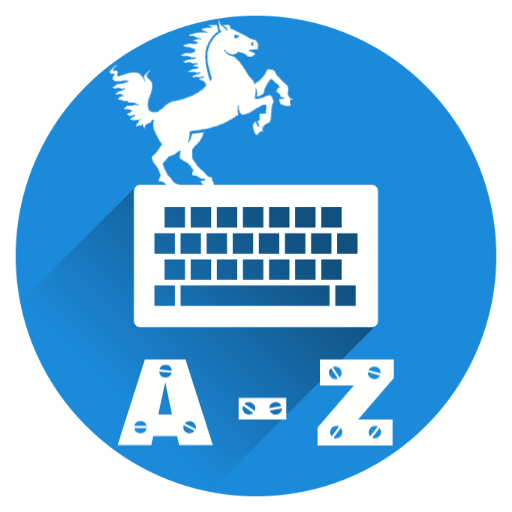
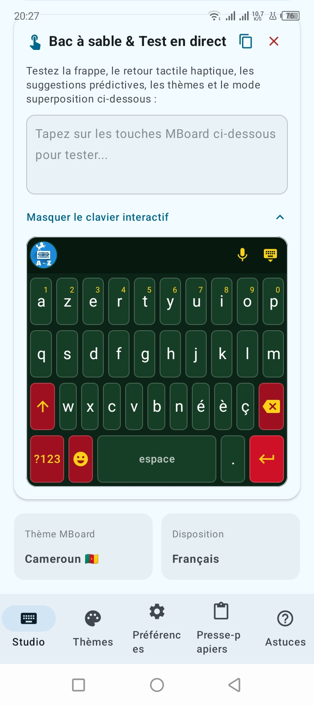
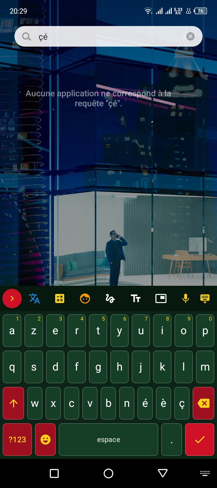
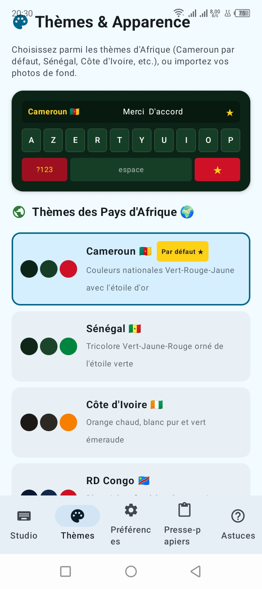

  

  <h1>Metadidomi Board</h1>
  
<strong>MBoard — votre clavier Android, personnalisable et plein d’outils.</strong>

  

    
    
    
  

## Fonctionnalités

### Saisie au quotidien

- Trois dispositions : **AZERTY**, **QWERTY** et **QWERTZ**, avec accès aux lettres accentuées par appui prolongé.
- Touches alphabétiques, rangées de chiffres et de symboles, majuscules et verrouillage des majuscules.
- Suggestions de mots, prédiction du mot suivant et correction automatique, activables dans les préférences.
- Soulignement orthographique et vérification grammaticale, configurables séparément.
- Dictionnaire personnel qui apprend les mots saisis, avec option pour effacer les mots appris.
- Majuscule automatique en début de phrase, retour à la ligne et touche d’action adaptée au champ de saisie.
- Réglages des sons de frappe, du volume, des vibrations et de leur intensité, ainsi que de l’aperçu agrandi des touches.

### Émojis, presse-papiers et texte

- Sélecteur d’émojis par catégories et recherche par mot-clé.
- Catégorie dédiée aux **kaomojis**.
- Historique des textes copiés, suggestion du dernier texte copié et insertion depuis le clavier.
- Phrases rapides personnalisées : ajout, insertion, épinglage, désépinglage et suppression.
- Outils d’édition : déplacer le curseur caractère par caractère ou ligne par ligne, aller au début ou à la fin, tout sélectionner, couper, copier et coller.
- **19 styles de texte** (par exemple gras, italique, manuscrit, gothique, petites capitales, barré, souligné et pleine largeur), sélectionnables dans les réglages ou depuis le clavier.

### Outils intégrés au clavier

- **Traducteur** avec saisie dédiée, sélection et inversion des langues, résultat insérable, copier/coller et lecture vocale. Les 14 langues proposées sont le français, l’anglais, l’espagnol, l’allemand, l’italien, le portugais, l’arabe, le chinois, le japonais, le russe, le swahili, le haoussa, le néerlandais et le turc.
- **Dictée vocale** depuis le clavier, utilisant le service de reconnaissance vocale disponible sur l’appareil.
- **Calculatrice** en mode simple ou scientifique, avec insertion du résultat dans le champ de texte.
- **Écriture manuscrite** au doigt ou au stylet, avec propositions de caractères à sélectionner.
- **Clavier Enfant** à grandes touches colorées, avec lettres, chiffres et formes, animaux et jouets, ainsi que des mots rapides.

### Apparence et personnalisation

- **15 thèmes** : Cameroun, Sénégal, Côte d’Ivoire, RD Congo, Nigéria, Mali, Afrique du Sud, Maroc, Bleu MBoard, Sombre AMOLED, Blanc minimaliste, Lavande pastel, Menthe fraîche, Nuit cyberpunk et Coucher de soleil.
- Image personnelle ou arrière-plan prédéfini, avec réglage de l’assombrissement pour préserver la lisibilité.
- Réglages visuels : contours des touches, rangée de chiffres dédiée et hauteur des touches.
- Mode flottant déplaçable et réglages de taille, largeur et position du clavier, avec réinitialisation des dimensions.
- Réorganisation personnalisée des touches, permutation de leur position et retour à la disposition par défaut.
- Préférences et apparence appliquées après confirmation.

### Application

- Écran d’accueil pour vérifier l’activation du clavier et accéder aux réglages Android nécessaires.
- Onglets **Studio**, **Thèmes**, **Préférences**, **Presse-papiers** et **Astuces**.
- Guide intégré avec astuces, version de l’application et lien vers le site officiel.

## Aperçu du clavier

<table>
  <tr>
    <td align="center">
       
      <strong>Clavier</strong>
    </td>
    <td align="center">
       
      <strong>Outils</strong>
    </td>
  </tr>
  <tr>
    <td align="center">
       
      <strong>Thèmes</strong>
    </td>
    <td align="center">
       
      <strong>Émojis</strong>
    </td>
  </tr>
</table>

## Installer et activer MBoard

1. Obtenez l’application ou générez son APK/AAB avec le projet [Metadidomi-Builder](https://github.com/METADIDOMIOFFICIEL/Metadidomi-Builder).
2. Installez l’application sur un appareil Android 7.0 (API 24) ou ultérieur.
3. Dans les paramètres Android, activez **Metadidomi Board** dans **Langues et saisie** > **Clavier à l’écran** (le chemin peut varier selon l’appareil).
4. Sélectionnez **Metadidomi Board** comme clavier actif, puis ouvrez un champ de texte.

## Générer un APK ou un AAB

Pour consulter la procédure de préparation et de compilation, rendez-vous sur le dépôt [Metadidomi-Builder](https://github.com/METADIDOMIOFFICIEL/Metadidomi-Builder).

## Confidentialité

Les suggestions et corrections intégrées sont traitées localement. La traduction en ligne transmet le texte à traduire au service de traduction utilisé par l’application. La dictée vocale dépend du service de reconnaissance vocale configuré sur l’appareil.

## Licence

MBoard est distribué sous la licence **GNU General Public License, version 2.0 (GPL-2.0)**. Consultez le [texte officiel de la licence](https://www.gnu.org/licenses/old-licenses/gpl-2.0.html) pour connaître les conditions de copie, de modification et de redistribution.

© 2026 METADIDOMI.

## En savoir plus

[Site officiel](https://metadidomi-global.com/) · [Dépôt Metadidomi-Builder](https://github.com/METADIDOMIOFFICIEL/Metadidomi-Builder)
